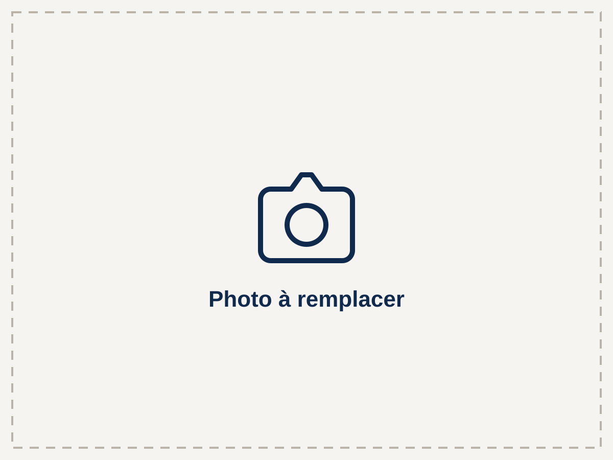

# BRB Multiservices — site vitrine

Site statique en HTML, CSS et JavaScript vanilla. Il n'y a ni framework ni étape de build : les fichiers s'hébergent tels quels (Netlify, OVH, o2switch…).

## Arborescence

```
/
├── index.html               Accueil
├── services.html            Services (une section par service)
├── realisations.html        Galerie avant / après
├── contact.html             Formulaire de devis + coordonnées
├── mentions-legales.html    Mentions légales + politique de confidentialité
├── merci.html               Page affichée après l'envoi du formulaire (non indexée)
├── sitemap.xml
├── robots.txt
├── site.webmanifest
├── netlify.toml             Configuration Netlify (aucun build)
└── assets/
    ├── css/style.css        Feuille de style unique
    ├── js/main.js           Menu mobile, année du footer, pré-sélection du formulaire
    └── img/
        ├── logo/            Pack logo officiel (fichiers d'origine, non modifiés)
        └── photos/          Photos des services et des chantiers
```

## 1. Placeholders à remplacer

Toutes les valeurs à personnaliser sont **entre crochets** `[…]`. Pour les retrouver toutes :

```bash
grep -rn "\[" --include="*.html" .
```

Utilisez le « Rechercher / Remplacer dans tous les fichiers » de votre éditeur (VS Code : `Ctrl+Maj+H`).

### Informations de l'entreprise (toutes les pages)

| Placeholder | Où | Remarque |
|---|---|---|
| `[Prénom NOM]` | Accueil, mentions légales, JSON-LD | Gérant |
| `[06 00 00 00 00]` | Partout (texte affiché) | Numéro affiché |
| `tel:+33600000000` | Partout (liens d'appel) | **À remplacer aussi** : format international sans espaces, ex. `tel:+33612345678` |
| `+33600000000` | JSON-LD de `index.html` | Même format |
| `[contact@brbmultiservices.fr]` | Partout (texte affiché) | |
| `mailto:contact@brbmultiservices.fr` / `contact@brbmultiservices.fr` | Liens email, JSON-LD, commentaire du formulaire | Adresse réelle, sans crochets |
| `[Ville]` | Titres, meta descriptions, textes, JSON-LD | Ville principale (important pour le référencement local) |
| `[Commune 1]` … `[Commune 6]`, `[liste des communes]` | Accueil (zone), contact, JSON-LD | Ajoutez ou retirez des `<li>` selon besoin |
| `[Code postal]` | JSON-LD | |
| `[Service 1]` … `[Service 4]` | Partout (menus, cartes, titres, formulaire, JSON-LD) | Noms des services |
| `[numéro]` (après « SIRET ») | Footer, mentions légales | |
| `[horaires]` | Accueil, contact, footer | Texte libre, ex. « Lun-ven 8h-18h » |
| `[Mo-Fr 08:00-18:00]` | JSON-LD de `index.html` | Horaires au format schema.org, ex. `Mo-Fr 08:00-18:00` |

### Textes

| Placeholder | Page |
|---|---|
| Phrase d'accroche du hero (« Un seul artisan pour tous vos travaux, faits proprement. ») | `index.html` — proposition de texte, à adapter |
| `[Une phrase qui présente l'ensemble de vos services…]` | `index.html` |
| `[Description courte du service N…]` | `index.html` (cartes) |
| `[Argument 1]` à `[Argument 3]` et leurs descriptions | `index.html` — « Pourquoi nous choisir ». Ne mettez que des éléments vérifiables (pas d'avis ni de chiffres inventés) |
| `[Une phrase d'introduction…]`, `[Présentez le service N…]`, `[Prestation incluse N]` | `services.html` |
| `[Titre du chantier N]`, `[Service] — [Commune]`, descriptions | `realisations.html` |
| Textes `alt` des photos `[Description de la photo…]` | `services.html`, `realisations.html` |

Les icônes des services (marteau, rouleau, maison, niveau) sont génériques : remplacez le SVG d'une carte si une autre icône correspond mieux au métier. Pensez à faire la même modification dans `services.html`.

### Mentions légales (`mentions-legales.html`)

`[forme juridique]`, `[montant]` (capital), `[adresse complète]`, `[RNE / RCS / Répertoire des métiers]`, `[numéro]` de TVA, `[assureur…]`, `[Nom de l'hébergeur]`, `[Adresse de l'hébergeur]`, `[Téléphone ou site web de l'hébergeur]`, `[nom du médiateur]` (obligatoire pour une clientèle de particuliers), `[3 ans]` (durée de conservation), `[date]` de mise à jour.

Pour Netlify, l'hébergeur est : *Netlify, Inc., 512 2nd Street, Suite 200, San Francisco, CA 94107, États-Unis — www.netlify.com* (à vérifier sur leur site au moment de la mise en ligne). Pour OVH ou o2switch, reprenez les coordonnées indiquées sur leur propre page de mentions légales.

### Nom de domaine

Le site est configuré pour le domaine `https://brbmultiservices.fr/` (sans `www`). En cas de changement de domaine, il faut le modifier dans :

- les balises `canonical` et `og:url` / `og:image` de chaque page HTML ;
- le JSON-LD de `index.html` ;
- `sitemap.xml` et `robots.txt`.

## 2. Ajouter les photos

1. Préparez des photos **au format paysage 4:3** (ex. 1200 × 900 px), en JPG ou WebP, de moins de 200 Ko chacune. Des outils gratuits comme [Squoosh](https://squoosh.app) permettent de les redimensionner et compresser.
2. Nommez-les simplement, sans espaces ni accents : `service-1.jpg`, `chantier-1-avant.jpg`, `chantier-1-apres.jpg`…
3. Déposez-les dans `assets/img/photos/`.
4. Dans le HTML, remplacez le chemin de l'image provisoire et décrivez la photo dans `alt` :

```html
<!-- avant -->

<!-- après -->

```

Gardez `width`/`height` (ils évitent les décalages au chargement) et `loading="lazy"`. Si votre photo n'est pas en 4:3, ce n'est pas grave : elle est recadrée automatiquement (`object-fit: cover`), mais indiquez ses vraies dimensions.

- **Services** (`services.html`) : une photo par bloc `<figure class="photo service-media">`.
- **Réalisations** (`realisations.html`) : chaque chantier a une image `placeholder-avant.svg` et une `placeholder-apres.svg`. Pour ajouter un chantier, copiez un bloc `<li>…</li>` complet ; pour en retirer un, supprimez son `<li>`.

Une fois toutes les photos en place, les fichiers `placeholder*.svg` peuvent être supprimés.

## 3. Le logo

Les fichiers de `assets/img/logo/` sont ceux du pack officiel, copiés sans modification :

| Fichier | Usage |
|---|---|
| `logo-principal.png` | Header (fonds clairs) |
| `logo-blanc-fond-fonce.png` | Hero et footer (fonds bleu marine) |
| `logo-principal-fond-blanc.jpg` | Image de partage Open Graph |
| `icone-512.png` | JSON-LD (logo) et manifest |
| `favicon.ico`, `favicon-32.png`, `apple-touch-icon-180.png` | Favicons, déclarés dans le `<head>` de chaque page |

Les originaux font 1858 px de large et pèsent jusqu'à 760 Ko, alors qu'ils s'affichent sur moins de 320 px. Pour tenir l'objectif de performance (Lighthouse ≥ 90 sur mobile), des copies **simplement réduites** ont été ajoutées : `logo-principal-400.png`, `logo-blanc-fond-fonce-400.png` et `logo-blanc-fond-fonce-800.png`. Elles ont les mêmes proportions et les mêmes couleurs ; le navigateur choisit la bonne taille via `srcset`, et l'original reste dans `src`. Pour ne servir que les originaux, supprimez les attributs `srcset` et `sizes` des balises `` du logo (le score de performance mobile descend alors vers 70).

La hauteur du logo est fixée en CSS (variable `--logo-h` dans `style.css`).

## 4. Le formulaire de contact

Sur Netlify, le formulaire fonctionne sans configuration : l'attribut `data-netlify="true"` est détecté au déploiement.

1. Dans Netlify : **Site configuration > Forms**, activez la détection des formulaires si elle est désactivée, puis redéployez.
2. **Forms > Form notifications > Add notification > Email notification** : indiquez l'adresse qui doit recevoir les demandes.
3. Les messages sont aussi consultables dans l'onglet **Forms**. Un champ piège (`bot-field`) filtre une partie des robots.

Après l'envoi, le visiteur arrive sur `merci.html`.

Hors Netlify (OVH, o2switch…), Netlify Forms ne fonctionne pas : un **fallback `mailto:`** est documenté en commentaire juste au-dessus du `<form>` dans `contact.html`. Il ouvre la messagerie du visiteur, ce qui est moins fiable ; chez ces hébergeurs, préférez un petit script PHP d'envoi ou un service comme Formspree.

Le lien « Demander un devis » de chaque service ouvre `contact.html?besoin=service-N`, ce qui pré-sélectionne le type de besoin.

## 5. Mettre le site en ligne sur Netlify

**Option A — glisser-déposer (le plus simple)**

1. Créez un compte gratuit sur [netlify.com](https://www.netlify.com).
2. Allez dans **Sites > Add new site > Deploy manually**.
3. Glissez-déposez le **dossier du site entier** (celui qui contient `index.html`).
4. Le site est en ligne en quelques secondes sur une adresse du type `nom-aleatoire.netlify.app`.
5. Pour une mise à jour, glissez-déposez de nouveau le dossier dans l'onglet **Deploys**.

**Option B — depuis GitHub (mises à jour automatiques)**

1. **Add new site > Import an existing project > GitHub**, puis choisissez ce dépôt.
2. Laissez la commande de build **vide** et le dossier de publication à `.` (c'est déjà ce que dit `netlify.toml`).
3. Chaque modification poussée sur la branche principale met le site à jour.

**Nom de domaine**

1. **Domain management > Add a domain** : saisissez `brbmultiservices.fr` et choisissez-le comme domaine principal (Netlify redirigera `www.brbmultiservices.fr` vers lui).
2. Suivez les instructions DNS de Netlify chez votre registrar (OVH, Gandi…). Le certificat HTTPS est automatique.
3. Remplacez le domaine provisoire dans les fichiers (voir plus haut), puis redéployez.

**Après la mise en ligne**

- Déclarez le site dans [Google Search Console](https://search.google.com/search-console) et soumettez `https://votre-domaine/sitemap.xml`.
- Créez ou mettez à jour votre fiche **Google Business Profile** avec le même nom, téléphone et adresse que sur le site : c'est le levier principal du référencement local.
- Vérifiez les données structurées avec le [test des résultats enrichis](https://search.google.com/test/rich-results).

## 6. Notes techniques

- **Couleurs** : marine `#102A4D`, orange `#E8711A`, orange texte `#C45508` (petit texte sur fond **blanc** uniquement : sur le blanc cassé `#F6F4F0`, son contraste passe sous le seuil AA), orange clair `#F28C38` (texte sur fond marine). Les boutons orange portent un texte marine (contraste 4,6:1) : du texte blanc sur cet orange ne passerait pas le seuil AA.
- **Police** : Archivo via Google Fonts. Pour éviter tout transfert vers Google (RGPD), vous pouvez héberger la police vous-même : téléchargez les fichiers `.woff2` (par exemple avec [google-webfonts-helper](https://gwfh.mranftl.com/fonts/archivo)), placez-les dans `assets/fonts/`, déclarez-les avec `@font-face` en haut de `style.css`, puis supprimez les trois balises Google Fonts du `<head>` de chaque page et le paragraphe correspondant dans la politique de confidentialité.
- **Header et footer** sont recopiés dans chaque page (pas d'étape de build). Une modification du menu ou des coordonnées doit donc être faite dans les 6 fichiers HTML : utilisez un « Rechercher / Remplacer dans tous les fichiers ».
- **Sans JavaScript**, le menu reste accessible (il s'affiche sous le logo) et le formulaire fonctionne.
- Scores Lighthouse mesurés en local (mobile, sans compression serveur) : performance 92 à 95, accessibilité 100, bonnes pratiques 100, SEO 100. Une fois les vraies photos ajoutées, vérifiez qu'elles restent légères.
